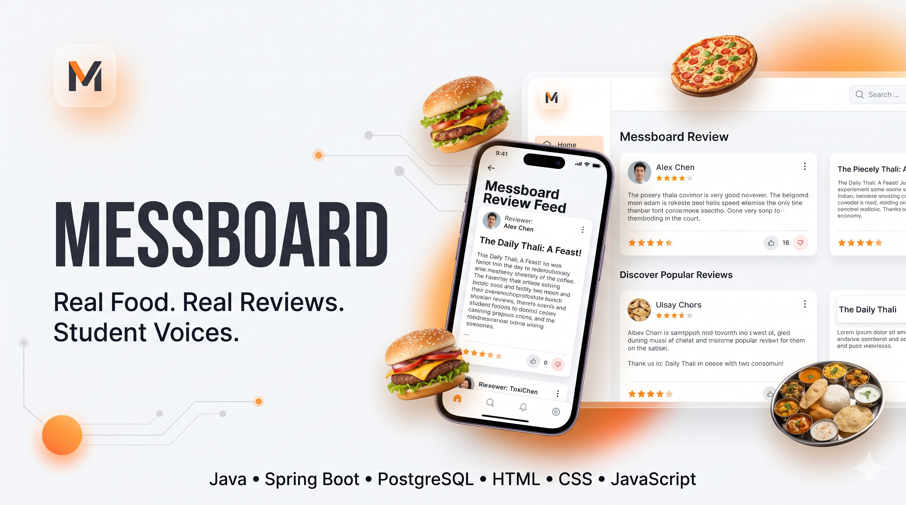

# 🍽️ MessBoard

<p align="center">
  
</p>

<h3 align="center">Real Food. Real Reviews. Student Voices.</h3>

<p align="center">
  A full-stack campus food review platform where students can share their dining experiences, discover reviews, and vote on opinions.
</p>

<p align="center">
  <a href="https://messboard.onrender.com/"><strong>🌐 Live Demo</strong></a>
  &nbsp; • &nbsp;
  <a href="https://github.com/AvgLucer/MessBoard"><strong>💻 GitHub Repository</strong></a>
</p>

<p align="center">
  
  
  
  
  
  
</p>

---

## 📌 About the Project

**MessBoard** is a full-stack web application designed to give students a platform to share honest reviews and experiences about campus food and mess facilities.

Students can publish reviews, share food images, explore other students' experiences, and interact with posts through an upvote and downvote system.

The project focuses on building a practical, responsive, and database-backed application using Java and Spring Boot, with a lightweight HTML, CSS, and JavaScript frontend.

## ✨ Features

| Feature | Description |
|---|---|
| 📝 Review Posting | Create and publish food and mess reviews. |
| 🖼️ Image Uploads | Attach images to reviews. |
| 👍 Upvotes | Support reviews shared by other students. |
| 👎 Downvotes | Express disagreement with a review. |
| 📰 Feed | Browse published reviews in one place. |
| 🔍 Explore | Discover content through the Explore section. |
| 🔔 Activity | Access the Activity section. |
| 💾 Database Persistence | Store posts and votes in PostgreSQL. |
| 📱 Responsive UI | Designed to work across desktop and mobile screens. |
| ⚡ Interactive Interface | Dynamic frontend interactions using JavaScript. |

## 🛠️ Technology Stack

### Frontend
- HTML5
- CSS3
- JavaScript

### Backend
- Java 17
- Spring Boot 3.5.7
- Spring Web
- Spring Data JPA
- Hibernate

### Database
- PostgreSQL
- Neon PostgreSQL

### Deployment & Tools
- Git and GitHub
- Docker
- Render
- Maven

## 🏗️ Application Architecture

MessBoard follows a client-server architecture.

```text
                 STUDENT
                    |
                    v
          HTML + CSS + JavaScript
                    |
                    v
              REST API
                    |
                    v
             Spring Boot
                    |
          +---------+---------+
          |                   |
          v                   v
     Controllers          Services
          |                   |
          +---------+---------+
                    |
                    v
             Spring Data JPA
                    |
                    v
              Hibernate ORM
                    |
                    v
            PostgreSQL (Neon)
```

### How It Works

1. A student accesses the MessBoard website through a browser.
2. The frontend sends HTTP requests to the Spring Boot backend.
3. Spring Boot controllers receive and process API requests.
4. Application logic interacts with the database through Spring Data JPA repositories.
5. Hibernate handles object-relational mapping between Java entities and PostgreSQL tables.
6. The backend returns responses to the frontend.
7. JavaScript dynamically updates the interface with the retrieved information.

## 🗄️ Database Design

MessBoard uses PostgreSQL hosted on Neon.

The database stores application information such as:

- **Posts:** Review content, post information, and associated data.
- **Votes:** Voting information associated with posts and users.

Spring Data JPA and Hibernate manage database operations, while Hibernate's schema update functionality helps maintain the database structure.

## 🚀 Running Locally

### Prerequisites

Make sure you have:

- Java 17 or later
- Maven
- Git
- A PostgreSQL database (Neon or local PostgreSQL)

### 1. Clone the Repository

```bash
git clone https://github.com/AvgLucer/MessBoard.git
```

```bash
cd MessBoard
```

### 2. Configure Environment Variables

The application uses environment variables for database configuration.

Set the following variables:

```text
DB_URL=your_postgresql_jdbc_url
DB_USERNAME=your_database_username
DB_PASSWORD=your_database_password
```

For Windows PowerShell:

```powershell
$env:DB_URL="your_postgresql_jdbc_url"
$env:DB_USERNAME="your_database_username"
$env:DB_PASSWORD="your_database_password"
```

Never commit actual database credentials to GitHub.

### 3. Run the Application

```bash
mvn spring-boot:run
```

### 4. Open MessBoard

Visit:

```text
http://localhost:8080
```

The Spring Boot application serves the frontend and backend from the same application.

## ☁️ Deployment

MessBoard is deployed using:

- **GitHub:** Source code management and version control.
- **Docker:** Application containerization.
- **Render:** Backend hosting and application deployment.
- **Neon:** Managed PostgreSQL database hosting.

### Live Application

🌐 **https://messboard.onrender.com/**

The deployed application connects to Neon PostgreSQL through environment-based configuration.

## 🧪 Testing

The application was manually tested for its core functionality, including:

- Homepage loading and navigation.
- Creating and displaying reviews.
- Uploading and displaying images.
- Upvoting and downvoting posts.
- Database persistence of posts and votes.
- Refreshing the application.
- Desktop and mobile responsiveness.
- Backend and database connectivity.

## ⚠️ Current Limitations

- Image uploads currently use local server-side file storage.
- Render's default filesystem is ephemeral, so uploaded images may disappear after a service restart or redeployment.
- Cloud-based image storage, such as Cloudinary, is a planned improvement.
- Render's free hosting tier may temporarily sleep after periods of inactivity.

These limitations do not affect the core review, feed, or voting functionality.

## 🔮 Future Enhancements

- Cloud-based persistent image storage.
- Student authentication and account management.
- User profiles and review history.
- Advanced search and filtering.
- Review categories and ratings.
- Improved moderation and reporting tools.
- Enhanced analytics and engagement statistics.

## 👨‍💻 Creator

<p>
  <strong>Created by AvgLucer | Gaurav W</strong>
</p>

<p>
  <a href="https://github.com/AvgLucer">
    
  </a>
  
</p>

---

<p align="center">
  <strong>MessBoard — Real Food. Real Reviews. Student Voices.</strong>
  <br>
  Built with Java, Spring Boot, PostgreSQL, and a passion for practical software development.
</p>

<p align="center">
  © 2026 AvgLucer | Gaurav W. All rights reserved.
</p>
